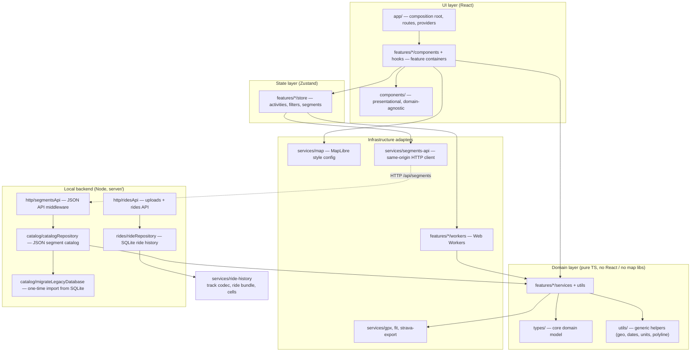
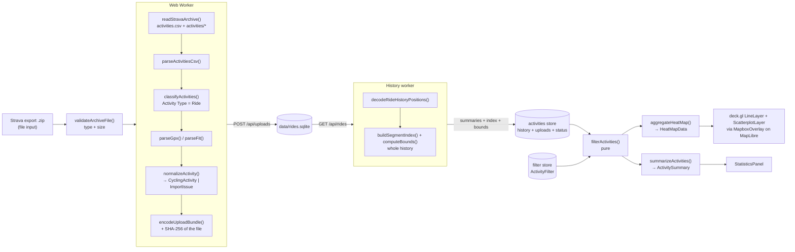
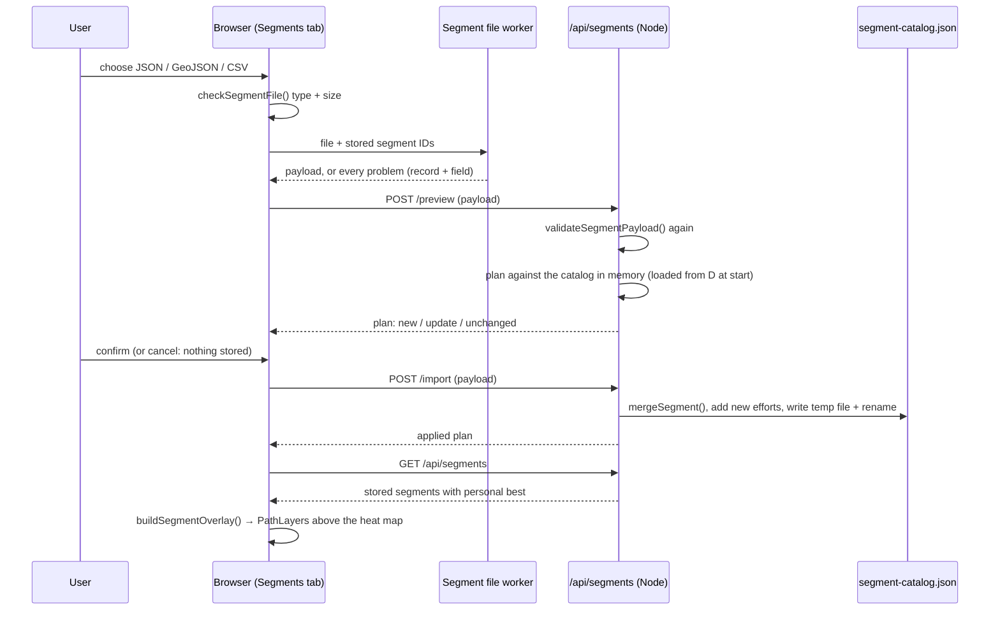
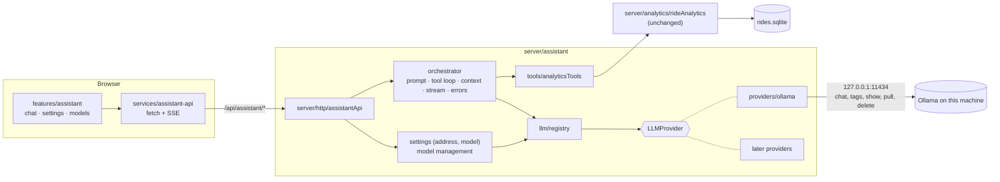

# Architecture

> Status: **Accepted**, aligned with `docs/BRD.md` v2.3. The local AI assistant of BRD v2.4
> (§4, "Assistant") is accepted (ADR-0014) and being implemented in phases.

## 1. Goals

- Keep **business logic separate from rendering**. Heat map preparation, filtering, normalization,
  statistics and segment validation are pure TypeScript functions that can be unit tested without a
  browser, React or the map library.
- **Feature modules** with explicit boundaries, so features can grow without tangling.
- **Rides are processed in the browser.** The Strava ZIP is read and parsed in a Web Worker
  ([ADR-0002](decisions/0002-client-side-gpx-processing.md),
  [ADR-0004](decisions/0004-strava-zip-ingestion-pipeline.md)); only the parsed rides are sent to
  the local backend.
- **Ride history is stored locally (BRD v2.3, [ADR-0013](decisions/0013-persistent-ride-history-sqlite.md)).**
  The same backend keeps parsed rides, their tracks and the upload registry in
  `data/rides.sqlite`. Each upload is processed in the worker, stored through `/api/uploads`, and
  the whole history is then read back from `/api/rides` and indexed in the worker.
- **Segments are stored locally.** A small Node backend, mounted on the Vite dev and preview
  servers, keeps imported segments in a local JSON segment catalog file
  ([ADR-0009](decisions/0009-local-backend-sqlite.md), [ADR-0011](decisions/0011-json-segment-catalog.md)). Segment data is uploaded by the user; the
  application never contacts Strava ([ADR-0010](decisions/0010-manual-segment-import.md), BR-28).
- **The assistant is local and behind one interface (BRD v2.4,
  [ADR-0014](decisions/0014-llm-agnostic-assistant.md)).** The backend runs the analytics as tools
  for a model in the user's own Ollama. The Ollama adapter is the only code that knows Ollama, and
  no analytics, ride or GPS code knows the assistant exists.
- **Traceability**: every feature can be traced back to a BRD requirement.

## 2. Layers



Arrows point from the dependent module to its dependency. **Dependencies only point downward or
inward.** The domain layer never imports from the UI, state or server layers. The backend reuses
the same pure segment services as the browser (validation, merge, import plan, personal best), so
the review the user sees is exactly what gets stored.

## 3. Separation of responsibilities

| Responsibility                                 | Location                                                                             | Kind                            |
| ---------------------------------------------- | ------------------------------------------------------------------------------------ | ------------------------------- |
| ZIP upload / replacement, file check           | `features/activities/components`, `features/activities/utils`                        | UI + pure                       |
| Archive reading (unzip, gunzip)                | `services/strava-export`                                                             | Pure adapter (fflate)           |
| `activities.csv` parsing                       | `services/strava-export`                                                             | Pure                            |
| Ride classification                            | `features/activities/services`                                                       | Pure                            |
| GPX parsing                                    | `services/gpx`                                                                       | Pure (text scanner)             |
| FIT parsing                                    | `services/fit`                                                                       | Pure adapter (@garmin/fitsdk)   |
| Activity normalization                         | `features/activities/services`                                                       | Pure                            |
| Import orchestration                           | `features/activities/workers`                                                        | Web Worker                      |
| Year and month filtering                       | `features/filters/utils`                                                             | Pure                            |
| Individual ride selection                      | `features/filters/utils` + `features/filters/store`                                  | Pure + state                    |
| Heat map data preparation                      | `features/heatmap/services`                                                          | Pure                            |
| Road-segment index (built at import, ADR-0006) | `features/heatmap/services/buildSegmentIndex`, called by the import worker           | Pure                            |
| Statistics calculation                         | `features/activities/utils`                                                          | Pure                            |
| Segment file parsing (JSON, GeoJSON, CSV)      | `features/segments/services/parseSegmentFile`, run in `features/segments/workers`    | Pure, in a Web Worker           |
| Segment validation, merge, plan, personal best | `features/segments/services`                                                         | Pure (browser and backend)      |
| Segment search, filter, sort, display text     | `features/segments/utils`                                                            | Pure                            |
| Segment map overlay data                       | `features/segments/utils/segmentOverlay`                                             | Pure                            |
| Segment API client                             | `services/segments-api`                                                              | Adapter (fetch)                 |
| Segment HTTP API                               | `server/http`                                                                        | Node middleware                 |
| Segment persistence                            | `server/catalog`, `server/segments` (interface, legacy SQLite reader), `server/db`   | Node + JSON file                |
| Track encoding, ride bundle, location cells    | `services/ride-history`                                                              | Pure (browser and backend)      |
| Ride history and upload registry (ADR-0013)    | `server/rides` (database, repository, upload validation), `server/http/ridesApi`     | Node + SQLite                   |
| Ride analytics (BR-38, ADR-0013 §7)            | `features/analytics/services` (pure), `server/analytics`, `server/http/analyticsApi` | Pure + Node                     |
| Upload management screen                       | `features/activities/components/UploadsSection`, `components/uploads/UploadList`     | UI (container + presentational) |
| Map rendering (heat map and segment overlay)   | `components/map`, `features/heatmap/components`, `services/map`                      | UI / adapter                    |
| Application state                              | `features/*/store`                                                                   | Zustand                         |

## 4. Data flow

### Rides (processed in the browser, stored by the local backend, ADR-0013)



### Segments (uploaded by the user, stored in the local JSON catalog)



Derived data (filtered activities, heat map data, statistics, the segment list order and the
segment overlay) is **computed, not stored**. It is recomputed from source state with memoized
selectors, so the different views can't drift out of sync. Segment state never feeds the ride
filters, heat map or statistics (RULE-18).

### Assistant (BRD v2.4, ADR-0014)



The model asks for analytics; the backend runs them on the stored history and returns the results
to the model. The answer streams to the browser with the analytics it used. Nothing goes to a
cloud service. Details: [ai-assistant.md](ai-assistant.md).

### Local API

| Method and path              | Purpose                                                           | Responses               |
| ---------------------------- | ----------------------------------------------------------------- | ----------------------- |
| `GET /api/segments`          | All stored segments with route and personal best, without efforts | 200                     |
| `GET /api/segments/:id`      | One segment with its efforts, fastest first                       | 200, 404                |
| `POST /api/segments/preview` | Validate a normalized payload and classify it; stores nothing     | 200, 400, 413, 415      |
| `POST /api/segments/import`  | Validate and apply a payload in one transaction                   | 200, 400, 413, 415      |
| `DELETE /api/segments/:id`   | Remove one segment and its efforts                                | 204, 404                |
| `DELETE /api/segments`       | Remove all segment data                                           | 204                     |
| `GET /api/uploads`           | Upload registry, newest first; `?hash=` finds an imported file    | 200, 400                |
| `POST /api/uploads`          | Store an upload's rides (binary ride bundle) in one transaction   | 201, 400, 409, 413, 415 |
| `POST /api/uploads/delete`   | Delete the given uploads and rides no other upload contains       | 200, 400, 404           |
| `DELETE /api/uploads`        | Delete every upload and all ride data                             | 200                     |
| `GET /api/rides`             | Every stored ride with its track, as a binary ride bundle         | 200                     |
| `GET /api/analytics`         | The analytics functions and their parameters                      | 200                     |
| `GET /api/analytics/:name`   | One analytics result (`{ result }`), from validated query params  | 200, 400, 404           |
| `/api/assistant/*`           | Assistant, settings, Ollama models (ADR-0014 §7)                  | SSE for answers, pulls  |
| any                          | Not from this machine, or from another site                       | 403                     |
| any                          | Database cannot be opened / unexpected failure                    | 503 / 500 (code only)   |

Errors are `{ "error": { "code": "…" } }`, plus `problems` for `invalid-payload`; they never
contain paths, SQL or stack traces (NFR-08).

## 5. Dependency rules

`eslint.config.js` enforces these rules with `no-restricted-imports`:

- `src/types`, `src/utils`, `src/services/{gpx,fit,strava-export,ride-history}`, `src/features/*/{services,utils,types}` **must not
  import** `react`, `react-dom`, `@deck.gl/*`, `maplibre-gl`, or any `components`
  module.

These conventions are not enforced by tooling:

- `src/components/**` is presentational. It takes props, holds no business rules, and does not read stores.
- `src/features/*/components` and `hooks` may read stores and call feature services.
- Features don't import each other's internals. Share code through `src/types`, `src/utils`, or by
  lifting it into `src/store`. The composition root (`DashboardRoute`) connects the segment
  overlay to the map.
- Only `src/services/map` and the map rendering components touch the MapLibre / deck.gl APIs (ADR-0008).
- `server/` imports the pure segment services by relative path. Those services may import only
  types through `@/` (type imports are erased); their value imports must be relative, so the Vite
  config bundler can load them.
- Nothing in `src/` imports from `server/`; the browser talks to it only over HTTP.
- Assistant (enforced by ESLint): only `server/assistant/llm/registry.ts` imports
  `llm/providers/*`; adapters don't import each other; `server/analytics`, `server/rides`,
  `server/catalog` and `src/` never import `server/assistant`. The chat UI uses only the
  provider-neutral API types.

## 6. Folder reference

```text
server/             Local backend (Node 22.13+): JSON segment catalog, SQLite migration, API, Vite plugin
server/assistant/   Local AI assistant (ADR-0014): llm/ (LLMProvider interface, errors, streams, loopback-only
                    localEndpoint, registry), tools/, orchestrator, evaluation, downloads, conversations
src/
├── app/            Composition root: App, routes (screens), providers, app config
├── components/     Domain-agnostic UI: layout, common, map, filters, statistics, segments
├── features/
│   ├── activities/ Ingestion, normalization, statistics helpers
│   ├── filters/    Filter UI, filter store, pure filter predicates
│   ├── heatmap/    Heat map data preparation (pure) + map layer components
│   └── segments/   Segment import, browsing, map overlay: services, utils, store, worker, UI
├── services/
│   ├── strava-export/ ZIP reading, activities.csv parsing, GPS file association
│   ├── gpx/        GPX XML parsing
│   ├── fit/        FIT parsing adapter
│   ├── map/        MapLibre style config and map helpers
│   └── segments-api/ Same-origin client for /api/segments
├── store/          Cross-feature stores (only when a store truly spans features)
├── types/          Core domain model shared across features
├── utils/          Generic, domain-neutral helpers (geo math, dates, units, polyline)
└── styles/         Tailwind entry and global styles
data/               segment-catalog.json (git-ignored; created on the first import)
```

## 7. Related documents

- [Technical design](technical-design.md): domain model, algorithms, open decisions
- [AI assistant](ai-assistant.md): interface, Ollama integration, model management, privacy, tests
- [Segment import format](segment-import-format.md)
- [BRD v2.0 gap analysis and implementation plan](implementation-plan-v2.md)
- [Architecture decision records](decisions/README.md)
- [Requirements traceability](traceability.md)
