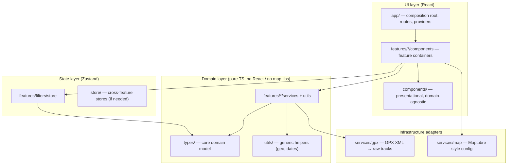
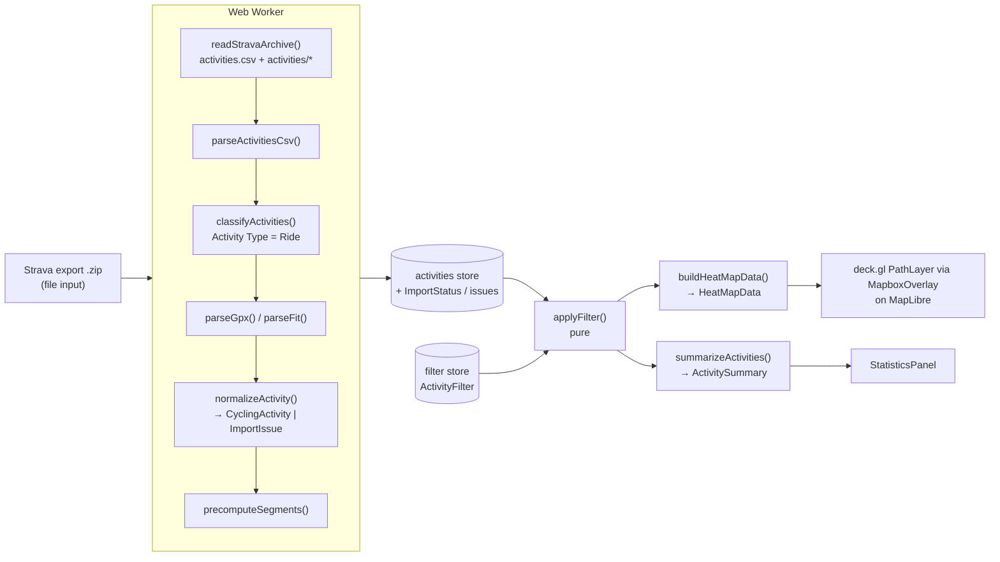

# Architecture

> Status: **Draft**. Target architecture, aligned with `docs/BRD.md` v1.1.

## 1. Goals

- Keep **business logic separate from rendering**. Heat map preparation, filtering, normalization
  and statistics are pure TypeScript functions that can be unit tested without a browser, React
  or the map library.
- **Feature modules** with explicit boundaries, so features can grow without tangling.
- **Client-side only.** No backend; the Strava ZIP is processed in the browser, in a Web Worker (see [ADR-0002](decisions/0002-client-side-gpx-processing.md) and [ADR-0004](decisions/0004-strava-zip-ingestion-pipeline.md)).
- **Traceability**: every feature can be traced back to a BRD requirement.

## 2. Layers



Arrows point from the dependent module to its dependency. **Dependencies only point downward or
inward.** The domain layer never imports from the UI or state layers.

## 3. Separation of responsibilities

| Responsibility                  | Location                                                        | Kind                          |
| ------------------------------- | --------------------------------------------------------------- | ----------------------------- |
| ZIP upload / replacement        | `features/activities/components`                                | UI                            |
| Archive reading (unzip, gunzip) | `services/strava-export`                                        | Pure adapter (fflate)         |
| `activities.csv` parsing        | `services/strava-export`                                        | Pure                          |
| Ride classification             | `features/activities/services`                                  | Pure                          |
| GPX parsing                     | `services/gpx`                                                  | Pure (DOMParser)              |
| FIT parsing                     | `services/fit`                                                  | Pure adapter (@garmin/fitsdk) |
| Activity normalization          | `features/activities/services`                                  | Pure                          |
| Import orchestration            | `features/activities/workers`                                   | Web Worker                    |
| Year and month filtering        | `features/filters/utils`                                        | Pure                          |
| Individual ride selection       | `features/filters/utils` + `features/filters/store`             | Pure + state                  |
| Heat map data preparation       | `features/heatmap/services`                                     | Pure                          |
| Map rendering                   | `components/map`, `features/heatmap/components`, `services/map` | UI / adapter                  |
| Application state               | `features/*/store`, `store/`                                    | Zustand                       |
| Statistics calculation          | `features/activities/utils`                                     | Pure                          |

## 4. Data flow (target)



Derived data (filtered activities, heat map data, statistics) is **computed, not stored**. It is
recomputed from `activities + filter` with memoized selectors, so the different views can't drift
out of sync.

## 5. Dependency rules (enforced)

`eslint.config.js` enforces these rules with `no-restricted-imports`:

- `src/types`, `src/utils`, `src/services/{gpx,fit,strava-export}`, `src/features/*/{services,utils,types}` **must not
  import** `react`, `react-dom`, `@deck.gl/*`, `maplibre-gl`, or any `components`
  module.

These conventions are not enforced by tooling:

- `src/components/**` is presentational. It takes props, holds no business rules, and does not read stores.
- `src/features/*/components` may read stores and call feature services.
- Features don't import each other's internals. Share code through `src/types`, `src/utils`, or by
  lifting it into `src/store`.
- Only `src/services/map` and the map rendering components touch the MapLibre / deck.gl APIs (ADR-0008).

## 6. Folder reference

```text
src/
├── app/            Composition root: App, routes (screens), providers, app config
├── components/     Domain-agnostic UI: layout, common, map, filters, statistics (presentational)
├── features/
│   ├── activities/ Ingestion, normalization, activity list, statistics helpers
│   ├── filters/    Filter UI, filter store, pure filter predicates
│   └── heatmap/    Heat map data preparation (pure) + map layer components
├── services/
│   ├── strava-export/ ZIP reading, activities.csv parsing, GPS file association
│   ├── gpx/        GPX XML parsing
│   ├── fit/        FIT parsing adapter
│   └── map/        MapLibre style config and map helpers
├── store/          Cross-feature stores (only when a store truly spans features)
├── types/          Core domain model shared across features
├── utils/          Generic, domain-neutral helpers (geo math, month helpers)
└── styles/         Tailwind entry and global styles
```

## 7. Related documents

- [Technical design](technical-design.md): domain model, algorithms, open decisions
- [Architecture decision records](decisions/README.md)
- [Requirements traceability](traceability.md)
