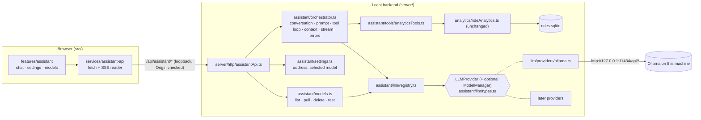

# 0014. Local, provider-neutral ride assistant (Ollama first)

- Status: **Accepted** (owner decision, BRD v2.4, 2026-11-20)
- Date: 2026-11-20
- Amends: [ADR-0013](0013-persistent-ride-history-sqlite.md) §7 (the analytics get their first
  caller). BRD v2.4 replaces the "no chatbot" scope line and revises NFR-03, NFR-05 and NFR-07.
- Related requirements: BR-39 – BR-45, RULE-25 – RULE-27, AC-43 – AC-53, NFR-03, NFR-05, NFR-07,
  NFR-11, NFR-12, US-09, US-10
- Details: [AI assistant: interface, Ollama, model management, privacy and testing](../ai-assistant.md)

## Context

The owner wants an assistant that answers questions about the stored ride history. Its numbers
must come from the deterministic analytics of BR-38, and all inference must run locally in
Ollama.

Owner decisions (2026-11-20):

1. **Ollama is the first and only provider.** No cloud providers (OpenAI, Anthropic, Gemini,
   OpenRouter), no cloud API keys, and nothing sent to a cloud service.
2. A model-neutral `LLMProvider` interface stays. A later provider must not need changes to the
   orchestrator, analytics, GPS processing, repositories or chat UI.
3. Ollama's native HTTP API is called with plain `fetch`. No SDK and no new dependencies.
4. Conversations are kept in memory only.
5. Segment matching (the segment part of BR-38, RULE-24) stays deferred.
6. Automated tests use mocked Ollama HTTP responses.

What exists already:

- `server/analytics/rideAnalytics.ts`: `RideAnalytics` over `RideRepository`.
  `src/features/analytics/services/parseAnalyticsQuery.ts` validates its inputs.
- `server/http/analyticsApi.ts`: `ANALYTICS_CATALOG`.
- The local backend runs as Vite middleware (`server/vitePlugin.ts`), with loopback and Origin
  checks, request validation and size limits (`server/http/apiSupport.ts`, NFR-07, NFR-08).

Ollama's API, checked against docs.ollama.com on 2026-11-20:

- **Endpoints:**
  - `GET /api/version`
  - `GET /api/tags` (installed models: `name`, `size`, `digest`, `modified_at`, `details` with
    `parameter_size` and `quantization_level`, and `remote_model` / `remote_host` for remote models)
  - `POST /api/show` (`capabilities`, `model_info["<arch>.context_length"]`)
  - `POST /api/pull` (an NDJSON progress stream of `status`, `total` and `completed`, ending with
    `status: "success"`)
  - `DELETE /api/delete`
  - `POST /api/chat`
- **Chat:** responses stream as NDJSON. `tools` uses the OpenAI-style function format. A tool
  call's `arguments` is a JSON **object** and has no id. Results go back as
  `{ role: "tool", tool_name, content }`. `format` takes a JSON Schema.
- **Errors:** bodies are `{ "error": "…" }`. A failure mid-stream arrives as an `{"error": …}`
  line, after the HTTP 200 has already been sent.
- **Cloud models:** names end in `:cloud` or `-cloud`, and `/api/tags` lists them with
  `remote_host` / `remote_model`. `OLLAMA_NO_CLOUD=1` disables them in Ollama itself.
- **Model library:** no API is documented for searching it.

## Decision

### 1. The assistant runs in the local backend

The browser never contacts Ollama. It calls `/api/assistant/*`, and the backend streams
normalized events back as server-sent events. The analytics tools run in-process on
`RideAnalytics`. The backend calls Ollama only at a loopback address (RULE-27).



Dependencies point inwards. The Ollama adapter depends only on `llm/types.ts` and
`llm/streams.ts`. The orchestrator and model management depend on the interface, never on the
adapter. The chat UI depends only on the provider-neutral API types in `src/types/assistant.ts`.
ESLint enforces three rules:

- only `llm/registry.ts` may import `llm/providers/*`;
- adapters may not import each other;
- `server/analytics`, `server/rides`, `server/catalog` and `src/` may not import
  `server/assistant/**`.

### 2. The provider interface

```ts
// server/assistant/llm/types.ts: application-level types, no provider formats
export interface LLMProvider {
  readonly descriptor: ProviderDescriptor; // id, display name, settings it needs (e.g. server address)
  /** Is the provider reachable? Generates nothing. */
  checkConnection(signal: AbortSignal): Promise<{ reachable: true; version: string | null }>;
  listModels(signal: AbortSignal): Promise<readonly ModelInfo[]>;
  /** One model turn: normalized events, exactly one `finish` at the end, or an LLMError. */
  generate(request: GenerateRequest, signal: AbortSignal): AsyncIterable<GenerateEvent>;
  /** Present only when models can be installed and removed through the provider (Ollama). */
  readonly models?: ModelManager;
}

export interface ModelManager {
  install(name: string, signal: AbortSignal): AsyncIterable<InstallProgress>; // { status, completedBytes, totalBytes }
  remove(name: string, signal: AbortSignal): Promise<void>;
}

export interface ModelInfo {
  id: string; // 'qwen3:8b'
  name: string;
  sizeBytes: number | null;
  parameterSize: string | null; // '8.2B'
  quantization: string | null; // 'Q4_K_M'
  contextWindow: number | null; // tokens
  capabilities: ModelCapabilities;
  location: 'local' | 'remote'; // remote models are never used (RULE-27)
  revision: string | null; // digest; a changed digest invalidates a model test
}

export interface ModelCapabilities {
  toolCalling: boolean | 'unknown';
  streaming: boolean | 'unknown';
  structuredOutput: boolean | 'unknown';
  other: readonly string[]; // e.g. 'thinking', 'vision', shown for information
}

export type ChatMessage =
  | { role: 'user'; text: string }
  | { role: 'assistant'; text: string; toolCalls: readonly ToolCall[] }
  | { role: 'tool'; callId: string; name: string; content: string; isError: boolean };

export interface ToolDefinition {
  name: string;
  description: string;
  parameters: JsonSchemaObject;
}
export interface ToolCall {
  id: string;
  name: string;
  arguments: unknown;
} // id assigned by the adapter if the provider has none

export interface GenerateRequest {
  model: string;
  system: string;
  messages: readonly ChatMessage[];
  tools: readonly ToolDefinition[];
  responseSchema?: JsonSchemaObject; // structured output, only when supported
  contextTokens: number;
  maxOutputTokens: number;
}

export type GenerateEvent =
  | { type: 'text'; delta: string }
  | { type: 'tool-call'; call: ToolCall }
  | { type: 'finish'; reason: 'stop' | 'tool-calls' | 'length'; usage: TokenUsage | null };

export class LLMError extends Error {
  kind:
    | 'unavailable'
    | 'timeout'
    | 'model-unavailable'
    | 'tools-unsupported'
    | 'busy'
    | 'context-too-long'
    | 'invalid-response'
    | 'model-error'
    | 'bad-request';
}
```

`ProviderDescriptor.settings` lists the settings a provider needs (Ollama: the server address,
with its default and the loopback rule). The settings screen renders them generically, so a
later provider doesn't change the UI code.

### 3. The Ollama adapter (`llm/providers/ollama.ts`)

| Concern      | How                                                                                                                                                                                                                                                                                                                                                                                      |
| ------------ | ---------------------------------------------------------------------------------------------------------------------------------------------------------------------------------------------------------------------------------------------------------------------------------------------------------------------------------------------------------------------------------------- |
| Address      | Default `http://127.0.0.1:11434` (not `localhost`: on Windows it can resolve to `::1`). It must be `http(s)` on `127.0.0.1`, `::1` or `localhost`, with no credentials or path (RULE-27, OD-36)                                                                                                                                                                                          |
| Connection   | `GET /api/version`, with a 3 s limit. A refused connection becomes `unavailable`, with guidance to start or install Ollama                                                                                                                                                                                                                                                               |
| Models       | `GET /api/tags`, then `POST /api/show` per model (cached by digest), giving `capabilities` and `model_info["<general.architecture>.context_length"]`. Size, parameter size and quantization come from `tags`                                                                                                                                                                             |
| Cloud models | `location: 'remote'` when `remote_host` or `remote_model` is set, or the name ends in `:cloud` / `-cloud`. Remote models are listed as "cloud model, not used" and can't be selected. The docs recommend `OLLAMA_NO_CLOUD=1` as well                                                                                                                                                     |
| Capabilities | `toolCalling` = `capabilities` contains `tools` (the value name is to be confirmed against a real `/api/show` while implementing; otherwise `unknown`, which the model test settles). `structuredOutput` = true for local models (Ollama's `format` takes a JSON Schema). `streaming` = true                                                                                             |
| Chat         | `POST /api/chat` with `stream: true`, `messages` (system first), `tools`, `options: { num_ctx, num_predict }`, `format` when a schema is given. Tool calls arrive whole, but chunks are still accumulated. The adapter gives each call an id (`call-<round>-<n>`) and turns `arguments` into the `unknown` value; results go back with `tool_name`. `thinking` text is not shown or kept |
| Install      | `POST /api/pull` with `stream: true`. Progress is relayed, and the stream ends with `status: "success"`. A name must be a valid Ollama model reference and must not end in `:cloud` / `-cloud`. Cancelling aborts the fetch; whether Ollama then stops the download is to be confirmed while implementing (docs are silent)                                                              |
| Remove       | `DELETE /api/delete` with `{ model }`. 404 becomes `model-unavailable`                                                                                                                                                                                                                                                                                                                   |
| Errors       | Mapping: 400 (including "does not support tools") → `tools-unsupported` or `bad-request`; 404 → `model-unavailable`; 500 → `model-error`; 503 → `busy`; an `{"error"}` line mid-stream → `model-error`; a line that isn't JSON, or a missing `done` → `invalid-response`; a refused connection → `unavailable`. Ollama's own error text is logged locally, not shown as is               |
| Timeouts     | 180 s to the first chunk (a model may be loading from disk), 60 s without data mid-stream, and no overall limit for a pull, only 120 s without progress (OD-37)                                                                                                                                                                                                                          |

### 4. Analytics as tools

`analyticsTools.ts` turns each `RideAnalytics` function into a tool. The JSON arguments are
converted to `URLSearchParams` and validated by the same parsers as `/api/analytics`, so a model
can't pass anything the HTTP API would refuse. When validation fails, the model gets a tool error
listing the problems (AC-44). The tools have their own JSON Schemas and descriptions, written for a
model, built from the shared limits in `parseAnalyticsQuery.ts`; `/api/analytics` is unchanged.

| Tool                | Function                                          |
| ------------------- | ------------------------------------------------- |
| `distance_by_month` | `RideAnalytics.distanceByMonth`                   |
| `distance_by_year`  | `RideAnalytics.distanceByYear`                    |
| `location_visits`   | `RideAnalytics.locationVisits`                    |
| `route_frequency`   | `RideAnalytics.routeFrequency` (at most 25 roads) |
| `compare_periods`   | `RideAnalytics.comparePeriods`                    |

The tools only read data. Results are capped at 8 KB to fit the model's context, and a result that
was cut says so. A segment-matching tool (phase 6) would be one more entry, with no change to the
adapter or the orchestrator.

### 5. The orchestrator

`createOrchestrator({ registry, tools, settings, conversations, clock })`; every dependency is
injected.

1. **Checks before sending** (RULE-26): Ollama is reachable, and the selected model is installed,
   local and tool-capable. If a check fails, nothing is sent; the user gets a specific message and
   chooses. The model is never changed by the app.
2. **System prompt:**
   - answer only from tool results, and never calculate or estimate ride numbers;
   - say when the tools can't answer;
   - use metric units;
   - include today's date, the time zone, and the history's ride count and date range.
3. **Context:** `num_ctx` is the model's context window, capped at 16,384 (Ollama's own default
   of 4,096 is too small for tool results). The conversation is trimmed to fit, oldest whole turns
   first, and the newest question is always kept.
4. **Tool loop:** `generate`, then execute the tool calls in order, then send the results. The
   tools are synchronous and local, bounded by NFR-10, so they have no separate time limit. At most 6 rounds per question.
5. **Streaming to the browser:** `text`, `tool` (name and arguments, shown as "Used: distance by
   month, 2024"), `done` and `error` events. Stop, or a closed tab, aborts the Ollama request.
6. **Errors:** each `LLMError` becomes a plain message (NFR-12). Nothing is retried with another
   model.

`conversations.ts` holds conversations in a `Map` in memory, with at most 20 conversations and the
oldest dropped first.

### 6. Model test (BR-43)

The **Test model** action (`evaluation.ts`) asks the model four fixed questions about a
synthetic history, locally, through the real tools and the real turn loop: distance per month,
visits to a place, a comparison of two years, and a question the analytics can't answer. Each case
checks tool selection, arguments, use of the results, and numbers that can't be traced (below). A
model is suitable only when every case passes. Untested and failed models are refused before
anything is sent, with no override (OD-38).

`evaluationStore.ts` saves each result in `data/assistant-settings.json`: provider, model, digest,
suite version (`EVALUATION_SUITE_VERSION`, raised whenever a case changes), time, overall result
and the result of each case. A result is valid only for the same digest and suite version; a model
without a reported digest can't be confirmed and stays untested. A file that can't be read is left
as it is, and nothing is saved over it.

**Traceable numbers** (`numberCheck.ts`, RULE-25): a number in an answer is allowed when it is in
the question, the system prompt, an earlier question or a tool result, or derives from one by
rounding (0–2 decimals), absolute value, the total of a list column, the difference of two values
in a list column, or a unit conversion given by the field's unit suffix (`…M` → km, `…Km` → m,
`…S` → minutes and hours, `…H` → minutes); a number in a question followed by `m` or `km` converts
too. Whole numbers up to 12 are allowed. The evaluation fails a case with any other number; in a
normal answer they are flagged with an `unverified-numbers` event before `done` (AC-55). They are
flagged rather than removed because the text has already been streamed.

### 7. Settings and local API

`data/assistant-settings.json` (git-ignored, written by the backend) holds
`{ provider: 'ollama', serverUrl, model }` and the model evaluation results (§6). It contains no secrets, and the assistant needs none.

All `/api/assistant` routes (`server/http/assistantApi.ts`) have the same loopback, Origin and
validation checks as the other APIs. Bodies are JSON objects of at most 16 KB with no unknown
fields; a question has at most 2,000 characters. Errors are `{ error: { code, message } }`, with
the plain message of the code (NFR-12) and never a provider's own text. `server/assistant/service.ts`
assembles the core for the API; `settings.ts` validates the settings, and `settingsFile.ts` is the
one shared, atomically written settings file.

| Method and path                    | Purpose                                                                                                                                  |
| ---------------------------------- | ---------------------------------------------------------------------------------------------------------------------------------------- |
| `GET /status`                      | Provider, address, reachable, version, selected model, `ready`, and the `problem` code and message that stops a question (RULE-26)       |
| `GET/PUT /settings`                | GET: settings and the providers with their settings. PUT `{ serverUrl?, model? }`: the address is validated as local, the model name too |
| `POST /test-connection`            | `{ serverUrl? }`: connection check against the given (validated) or saved address                                                        |
| `GET /models`                      | Installed models with details, capabilities, `local`, `selected`, suitability, last valid test result; and the downloads                 |
| `POST /models/install`             | `{ name }`; an SSE stream of the download's state. A second request joins the running download; closing the last stream cancels it       |
| `DELETE /models/:name`             | Remove a model (the UI confirms first); answers `selectionCleared` when it was selected (AC-49)                                          |
| `POST /models/:name/test`          | Run the model test and save the result; one test per model at a time (`model-test-running`)                                              |
| `POST /conversations`              | Start a conversation                                                                                                                     |
| `POST /conversations/:id/messages` | `{ question }`; answers with a `text/event-stream` of `AssistantEvent`s. Closing it stops the answer (Stop)                              |
| `DELETE /conversations/:id`        | Forget it                                                                                                                                |

Model names in paths are URL-encoded (`qwen3%3A8b`).

## Adding a provider later

1. Write `server/assistant/llm/providers/<name>.ts` implementing `LLMProvider`, and `ModelManager`
   only if it can install models.
2. Add one entry to `llm/registry.ts`.
3. Add its tests, running the shared provider contract tests on mocked HTTP.

The orchestrator, tools, analytics, repositories, API and chat UI don't change. A **cloud**
provider would also need a BRD change: v2.4 rules out cloud inference (BR-44), and adding it would
need consent, keys and data rules first.

## Consequences

- No new dependencies, and no data leaves the machine.
- The assistant needs Ollama and a downloaded tool-capable model. Without them it explains what
  to do, and the rest of the app is unaffected.
- Local models vary in how well they call tools, which is why the model test exists. Speed depends
  on the machine.
- Ollama's API changes between versions. The adapter reads only documented fields, and the
  contract tests pin the expected shapes.

## Implementation phases

See `docs/implementation-plan-v2.4.md`.
